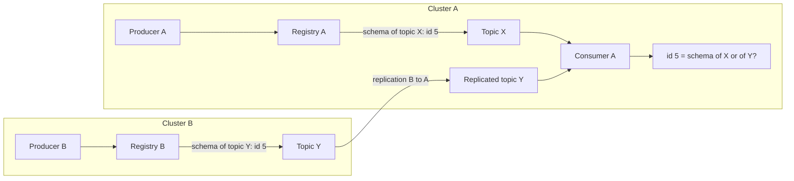
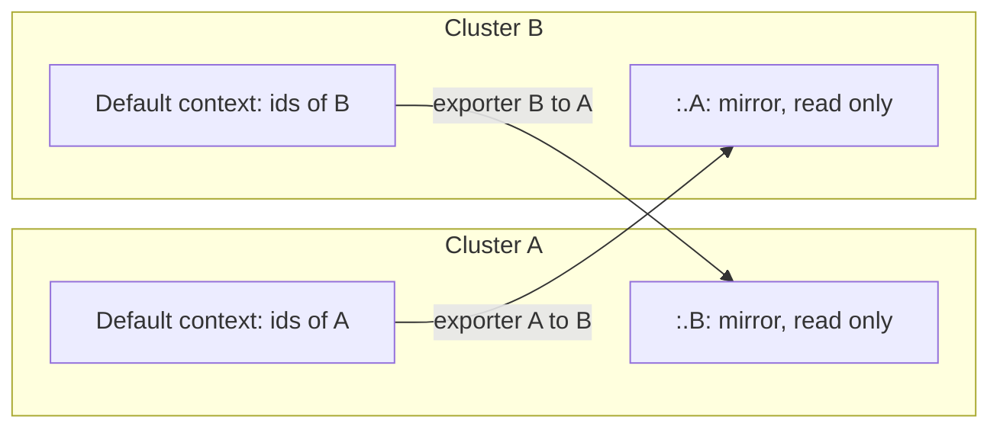
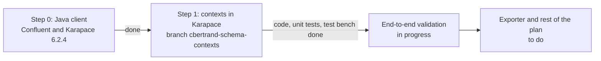
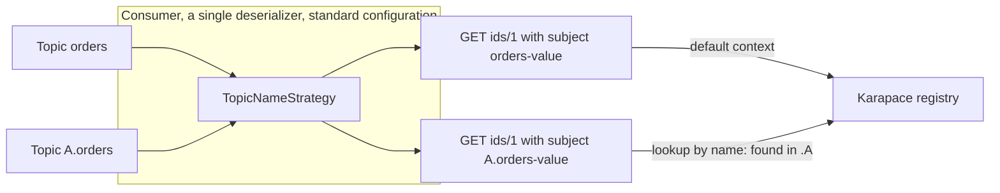
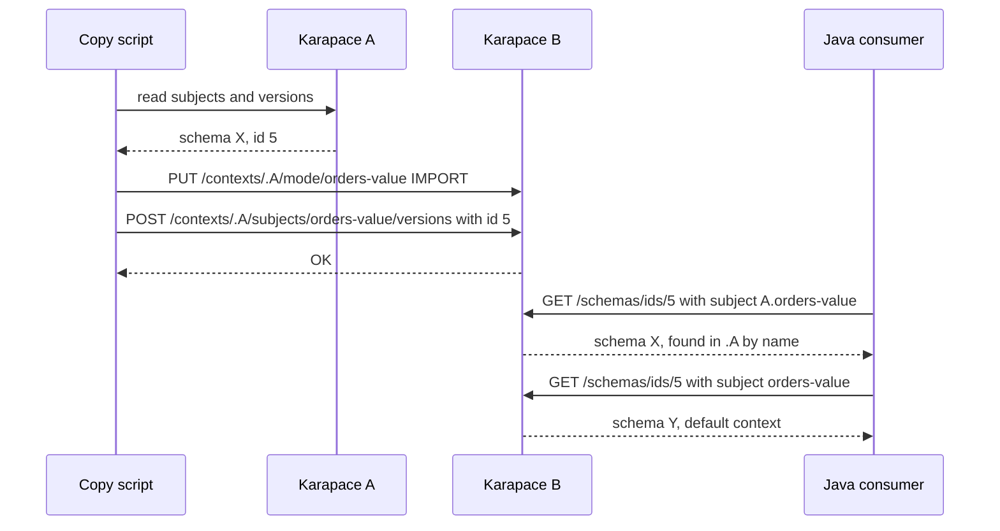
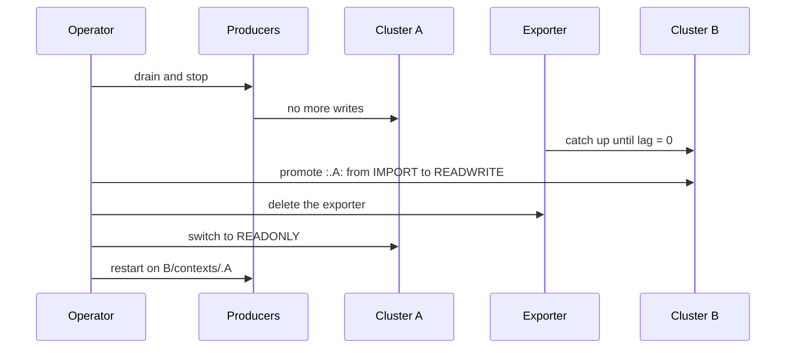

# Karapace: schema linking with contexts — Design v2 (condensed)

- Author: Cedric Bertrand
- Date: 2026-11-11, updated 2026-11-12
- Status: PoC in progress. Step 0 done; contexts implemented in Karapace (branch `cbertrand-schema-contexts`) and checked with the test bench; integration tests and the two-Karapace scenario still to run
- Detailed version: `Karapace_schema-linking-design_v2_complet_2026-11-11.md`

---

## 1. Problem and goal

- Each Karapace cluster allocates its own ids. In active-active, two clusters can give the **same id to two different schemas**: replicated messages are then decoded with the wrong schema.
- Confluent avoids this with Schema Linking and **contexts** (independent id namespaces).
- Goal: replicate schemas between clusters while keeping id and version, without collision, with unchanged Confluent clients.

## 2. Principle

- A context is an independent namespace of ids and subjects: the same id in two contexts names two different schemas.
- Each cluster only writes to its **default context**.
- The link writes to a **mirror context** of the other cluster (`:.A:` on B), read only, with the original ids.
- Replicated messages keep their original id, resolved in the matching mirror.

## 3. What has been done

### 3.1 Step 0: the Java client against a reference registry

Test bench: `tmp/schema-context-client/`. A podman compose file (Kafka `apache/kafka` 4.4.0 in KRaft) starts, one profile each, the Confluent Schema Registry community edition 8.4.1, Karapace 6.2.4, or Karapace built from the branch. A Java client (`kafka-avro-serializer` 8.4.1) runs the scenario, configured only with standard client settings in a YAML file.

Scenario: two `KafkaAvroSerializer` producers write `orders` (default context) and `A.orders`. The producer of A has `schema.registry.url=…/contexts/.A`, which puts its schemas where the exporter would copy them. Both schemas get id 1. A single consumer, with a single `KafkaAvroDeserializer` and no context option, reads both topics; a local proxy records the requests sent to the registry.

| Check | Confluent 8.4.1 | Karapace 6.2.4 |
| --- | --- | --- |
| Registration through `…/contexts/.A` | OK, id 1 in `.A` | Fails, no `/contexts` route |
| Same id 1 in two contexts | OK | Not reproducible |
| `orders` decoded | OK | OK |
| `A.orders` decoded, standard configuration | OK | Not testable, no message |
| `GET /schemas/ids/{id}?subject=` | Resolves the context | Parameter ignored |

Findings that change the design:

- **The client sends no qualified subject without configuration.** With `TopicNameStrategy`, the deserializer sends `GET /schemas/ids/1?subject=A.orders-value`, unqualified.
- **The reference registry finds the context.** An unqualified subject that does not hold the id in the default context is looked up by its name in every known context. `A.orders-value` only exists in `.A`, so the id is resolved there.
- **`ContextNameStrategy` is therefore not needed** when replicated topics are prefixed with their origin. The client library only ships `NullContextNameStrategy`, no topic to context strategy.
- **The context in the URL** (`schema.registry.url=…/contexts/.A`) is a standard configuration that works on the producer side.

### 3.2 Step 1: contexts in Karapace

Branch `cbertrand-schema-contexts`, with the goal of changing as little code as possible. IMPORT mode (explicit `id` and `version`, id and version conflicts rejected) and the persistence of `/mode` in `_schemas` already existed in Karapace.

**Data model, revised from the initial v2**

- The context is carried by the **qualified subject** `:.ctx:subject`, stored as is in `_schemas`, as the reference registry does. No `context` field: the message format and `schema_reader` do not change.
- `InMemoryDatabase` keeps an id table and an id counter **per context**, derived from the subject, also when replaying `_schemas`.
- Ids are allocated in the context of the subject; IMPORT mode checks id conflicts in that context only.

**API**

- `/contexts/{ctx}/subjects|config|mode/{subject}…` and `/contexts/{ctx}/schemas/ids/{id}…` are rewritten by a middleware onto the existing routes, in the context.
- `GET /schemas/ids/{id}?subject=…` resolves the context, with the same lookup as the reference registry:
  1. subject qualified with a named context: that context only;
  2. otherwise the default context, if the id belongs to that subject there;
  3. otherwise the first context where `:.ctx:subject` holds the id;
  4. otherwise the default context.
- `GET /contexts` lists the contexts.

**Consumer side, revised from the initial v2**

- No context option: `schema.registry.url` only, `TopicNameStrategy` by default.
- Unchanged prerequisites: replicated topics named after their origin (`A.orders`), one topic = one id namespace, never written by two clusters.
- The 404 without fallback is dropped in favour of the lookup by subject name.

**Code and tests**

| File | Change |
| --- | --- |
| `core/contexts.py` (new) | Parsing and building qualified subjects |
| `core/in_memory_database.py` | Id tables and counters per context |
| `core/schema_registry.py` | Id allocation and IMPORT per context, resolution with lookup by name |
| `api/routers/schemas.py`, `api/controller.py` | `?subject=` parameter on `GET /schemas/ids/{id}` |
| `api/middlewares/contexts.py` (new) | Rewriting of `/contexts/{ctx}/…` URLs |
| `api/routers/contexts.py` (new) | `GET /contexts` |

About 120 lines changed in existing files, 150 in the new modules. 50 unit tests added; the 1620 unit tests pass, so do mypy and ruff. An HTTP integration test (`tests/integration/test_schema_registry_contexts.py`) is written but not run yet.

The Step 0 scenario, run against the `karapace-dev` profile, gives the same result as the reference registry.

## 4. Implementation limits

| Limit | Consequence | Way forward |
| --- | --- | --- |
| An earlier Karapace version reads qualified subjects back into a single id namespace | Downgrading is unsafe once a schema is written to a context: colliding ids overwrite each other | No downgrade after enabling; feature flag rejecting qualified subjects until the whole fleet is upgraded |
| A subject already named `:.x:...` before the upgrade changes id namespace | Its ids are resolved in context `.x`, no longer in the default context | Audit `_schemas` before upgrading (section 5.3) |
| Lookup by name: an unqualified subject is looked up by its name in every context | If the same name exists in several contexts, the first context found wins (default, then alphabetical order) | Replicated topic names prefixed with their origin |
| No mode or config for a whole context (`/contexts/.A/mode` without a subject) | IMPORT and promotion are done subject by subject | Context mode stored under subject `:.A:` and inherited by its subjects |
| `GET /subjects` is not filtered by context | All subjects are listed, with qualified names | `subjectPrefix` parameter |
| `/schemas`, `/schemas/ids/{id}/versions` and `/schemas/ids/{id}/subjects` ignore the context | They only see the default context | Same `?subject=` resolution as `GET /schemas/ids/{id}` |
| References across contexts not handled | A reference is resolved by its subject name, with no context rule | To handle with the exporter (topological order of references) |
| End-to-end validation incomplete | Unit tests green, Step 0 OK on `karapace-dev`; integration test and two-Karapace scenario still to run | Section 5.1 |

## 5. What remains to be done

### 5.1 Validate the implementation

1. Run the integration test `tests/integration/test_schema_registry_contexts.py`.
2. Check a registry restart with the test bench (`scenario.consume-only`): same ids and same decoding after replaying `_schemas`.
3. Run the two-Karapace scenario below, with a copy script (about 50 lines) instead of the exporter.

| Scenario | Check | Status |
| --- | --- | --- |
| 1. Collision at the source | A and B give id 5 to two different schemas | To do |
| 2. Copy of A into `.A` of B | `B /contexts/.A/schemas/ids/5` returns the schema of A, `B /schemas/ids/5` the one of B | Covered by the integration test, to run |
| 3. Idempotence and conflicts | Replaying the copy changes nothing; same id with another content in `.A`: rejected; explicit `id` outside IMPORT: rejected | Existing IMPORT logic, to check in a context |
| 4. Restart | Replaying `_schemas` rebuilds contexts and counters | Covered by a unit test; test bench read-only mode ready, to run |
| 5. Java consumer on two topics | `orders` and `A.orders` decoded, standard configuration | Done with Confluent and with `karapace-dev` |
| 6. Manual promotion | Subjects of `.A` switched to `READWRITE`, a new schema gets max + 1 | To do, subject by subject |

### 5.2 Complete Karapace according to the limits kept

- Mode and config at context level, needed for a promotion in a single operation.
- `subjectPrefix` filter on `GET /subjects` and context on the other `/schemas` routes.
- Upgrade and downgrade strategy: feature flag, rolling upgrade order.

### 5.3 Exporter

- External component (sidecar or Kafka Connect) that reads the source `_schemas` and posts to the target context with the original ids, in IMPORT mode.
- Target context: `AUTO` (name of the source cluster), `CUSTOM`, or `NONE` (default).
- Topological order of references; propagates versions, deletes and compatibility configs.
- Idempotent, offset checkpoint, filter by subject.
- **Loop prevention**: a schema coming from a mirror is never exported again.
- Main metric: the lag.

Existing history on both sides:

1. Audit both `_schemas`: id collisions, subject conflicts, subjects already named `:.x:...`.
2. Scan the replicated topics to find the ids actually used (a collision on a local topic has no impact).
3. Each history stays in its default context, the other side receives it in a mirror: **no renumbering**, collisions disappear through isolation.
4. Start with a dry run, then one direction, then both.

### 5.4 Producer migration (end of the link)

Principle: **the id namespace follows the topic, not the cluster.**

- **New B**: exporter in `NONE`, so writes go to the default context of B; at cutover, only the producer URL changes.
- **B with its own history**: context `:.A:` is **promoted** (`IMPORT` to `READWRITE`) and producers point to `B/contexts/.A`, a configuration validated in Step 0. Never write to the default context of B for these topics.
- Safeguards: promotion rejected while the lag is not zero; auto-register disabled in production; rollback = reverse exporter.

### 5.5 Plan

| Milestone | Content | Status | Remaining estimate |
| --- | --- | --- | --- |
| M1 | IMPORT mode, POST with `id` and `version`, replay | Already in Karapace; made context aware | — |
| M2 | Contexts in the in-memory database and `_schemas` | Done (qualified subject), end-to-end validation in progress | A few days |
| M3 | API (`/contexts`, qualified subjects, `?subject=`, modes) | Partial: route rewriting, `?subject=` with lookup by name, `GET /contexts`; missing context mode, `subjectPrefix`, other `/schemas` routes | 1–2 weeks |
| M4 | Exporter (AUTO/CUSTOM/NONE, checkpoint, loop prevention) | To do | 3–4 weeks |
| M5 | Context promotion with lag safeguard | To do, depends on the context mode (M3) | 1–2 weeks |
| M6 | Client conformance tests, documentation | Java test bench done (Step 0); other clients to cover; `ContextNameStrategy` no longer needed | 1 week |

Estimates to be confirmed after the end-to-end validation.

**Discarded alternative**: disjoint id ranges per cluster. Simpler, but without isolation and without a solution for a colliding history.

## 6. Main risks

| Risk | Mitigation |
| --- | --- |
| Downgrade to a version without contexts | Feature flag, no downgrade after the first schema written to a context |
| Wrong context on the consumer side | Replicated topic names prefixed with their origin, one topic = one id namespace; lookup by subject name |
| Behaviour differences with the reference registry | Step 0 test bench run on every version, integration test |
| Promotion with a non-zero lag | Promotion rejected while the lag is not zero |

## 7. Open questions

- Exporter in the Karapace repository or in a separate project?
- Feature flag to enable contexts, or enabled as soon as upgraded?
- Do non-Java clients (Python, Go, .NET) send `?subject=` on `GET /schemas/ids/{id}`? Without it, only the default context is resolved.
- Is a whole-context mode needed before M5, or is a subject-by-subject promotion enough?
